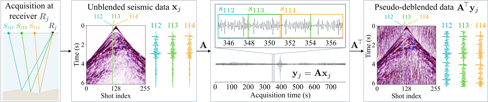
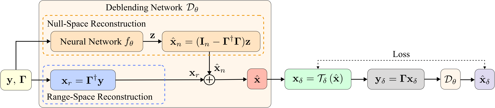

# NullBlend

NullBlend is a self-supervised method for seismic data deblending based on
bootstrapped null-space learning.

## The deblending problem



**Blending and pseudo-deblending.** At a single receiver, the blending operator
$A$ combines traces from different shots into one continuous recording.
Applying its transpose $A^{\top}$ produces a pseudo-deblended gather with
interference from overlapping shots. The colored traces follow shots 112,
113, and 114 through the process.

## Method



**Overall architecture of the proposed NullBlend approach.** The deblending
network 𝒟<sub>θ</sub> combines the range-space reconstruction module with a
learned null-space reconstruction module. The estimated wavefield **x̂** is
transformed to generate self-supervised training targets **x**<sub>δ</sub>.
The deblending network 𝒟<sub>θ</sub> is then optimized to recover these
targets from their reblended measurements **y**<sub>δ</sub>.

## Installation and training

Python 3.10+ with PyTorch and Matplotlib is required.

```bash
python run_nullblend.py --dataset mobil --device cuda:0
python run_nullblend.py --dataset seam --device cuda:0
python run_nullblend.py --dataset marmousi --device cuda:0
```

Download the datasets at https://drive.google.com/drive/folders/1dmqDBCVbtocsXmA7UTAqaBzXEEXaskJ8?usp=sharing. If you have any questions, please contact me at pansr24@mails.jlu.edu.cn.

## Results

| Dataset | Overall S/N (dB) |
|---|---:|
| Mobil | 26.764458 |
| SEAM | 22.932487 |
| Marmousi | 30.255144 |
